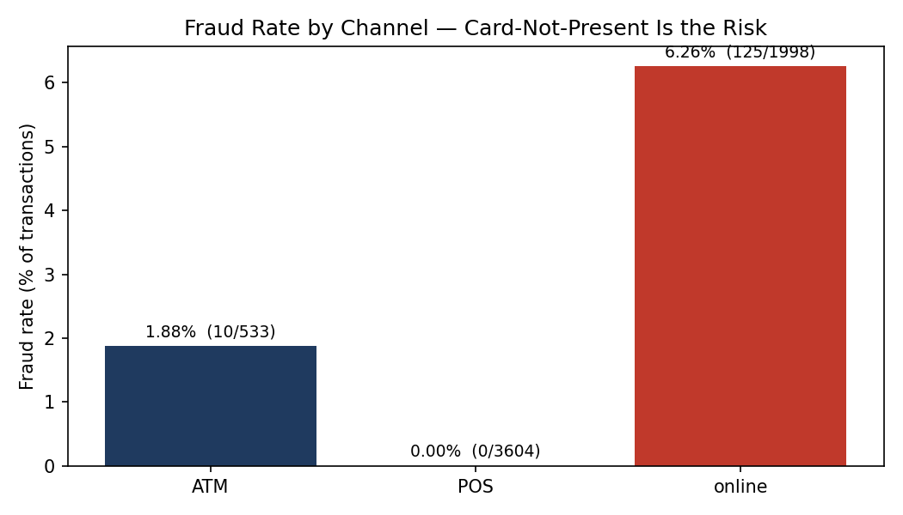
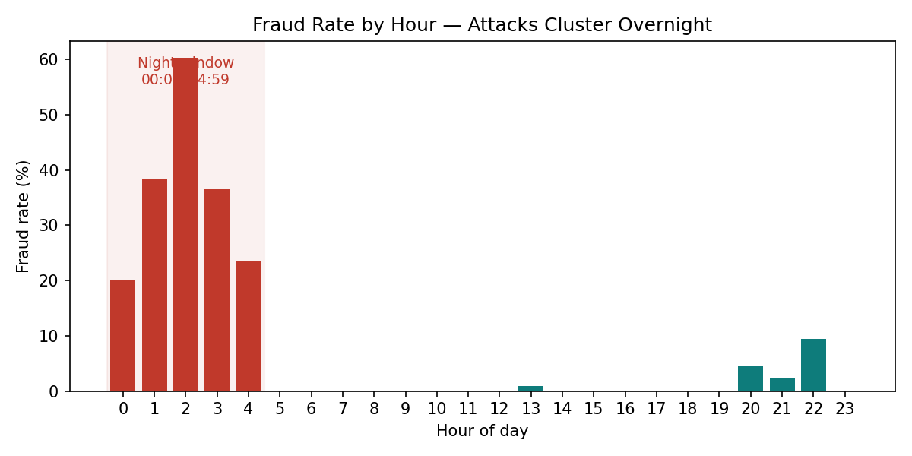
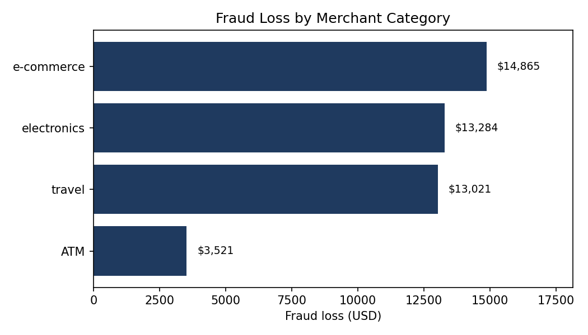

# Card Fraud Analytics: Transaction Fraud Detection, False-Positive Control and Chargeback Analysis

      

> **Portfolio project — synthetic data only.** This repo reproduces the day-to-day work of a **card fraud / payment operations analytics team** at a bank (the Bank of America type of role): monitoring transaction fraud, tuning detection rules, quantifying false positives, and estimating chargeback exposure. No real customer data is used, and this is not paid work experience.

## The business problem

Every card issuer loses money two ways: fraud that slips through, and good customers insulted by false declines and fraud alerts. A fraud analyst's job is to measure both sides of that trade-off, find where attacks concentrate (channel, hour, merchant category, geography), evaluate the detection rules honestly, and translate the surviving fraud into the language finance understands — **chargebacks**.

This project does exactly that on 6,135 synthetic card transactions with realistic, planted fraud patterns: card-not-present and foreign concentration, overnight attack windows, big-ticket electronics/travel purchases, sub-$3 **card-testing probes** before large fraud, and **velocity bursts** on compromised cards.

## Headline KPIs (actual outputs from running this repo)

| KPI | Value |
|---|---|
| Total transactions | 6,135 |
| Fraud transactions | 135 |
| Fraud rate | **2.20% = 220 basis points** |
| Total fraud loss | **$44,690.44** |
| Average fraud ticket | **$331.04** (vs $89.80 legitimate) |
| Fraud via online (card-not-present) | **92.59%** |
| Overnight fraud share (00:00–04:59) | 83.7% |
| Estimated chargebacks (65% proxy) | ~88 chargebacks · **$29,048.79** |
| Rule set — flagged | 237 transactions |
| Rule set — **precision** | **44.73%** |
| Rule set — **recall** | **78.52%** |
| Estimated loss prevented by rules | **$41,916.02 (93.8% of fraud $)** |

## Dashboard






## Key insights

- **Fraud is a card-not-present problem:** 125 of 135 frauds are online, a 6.26% fraud rate versus 0.00% at POS in this dataset. Chip/PIN at the terminal is doing its job; the battleground is e-commerce.
- **Attacks cluster overnight:** 83.7% of fraud lands between midnight and 5am, when cardholders are asleep and slow to confirm alerts — a strong argument for stricter night-time step-up authentication.
- **Three categories hold nearly all the loss:** e-commerce ($14,864.56), electronics ($13,283.70) and travel ($13,020.99) — high-value, easily resold or refundable purchases.
- **Rules catch the money, not just the count:** the combined rule set recalls 78.52% of fraud transactions but 93.8% of fraud *dollars*, because it catches the large tickets.
- **Every rule is a trade-off:** velocity (R4) is 100% precise but fires twice; the amount rule (R1) catches volume at 36.15% precision, interrupting 83 good customers. Tuning is a business decision, and this repo reports both sides.

## Detection rules (transparent, no ML)

| Rule | Logic | Precision | Recall |
|---|---|---|---|
| R1 Amount | Amount above per-category threshold | 36.15% | 34.81% |
| R2 Online + Foreign | Card-not-present AND foreign | 73.03% | 48.15% |
| R3 Night | 00:00–04:59, > $100, non-ATM | 74.04% | 57.04% |
| R4 Velocity | 3rd+ txn on a card within 10 minutes | 100.00% | 1.48% |
| **Combined** | Any rule fires | **44.73%** | **78.52%** |

## Repository structure

```
banking-card-fraud-analytics/
├── README.md                  ← you are here
├── analysis.py                ← rule engine + KPI evaluation
├── charts.py                  ← 4 matplotlib charts
├── requirements.txt
├── LICENSE  ·  .gitignore
├── data/transactions.csv      ← 6,135 transactions
├── sql/analysis_queries.sql   ← 10 commented SQL queries
├── outputs/                   ← kpi_summary.csv, rule_performance.csv,
│                                fraud_by_channel.csv, insights.md
├── images/                    ← 4 chart PNGs (embedded above)
├── data_dictionary.md
```

## How to run

```bash
pip install -r requirements.txt
python3 analysis.py          # writes outputs/*.csv + outputs/insights.md
python3 charts.py            # writes images/*.png
```

Then open `dashboard/dashboard.html` in a browser.

## SQL highlights (`sql/analysis_queries.sql`)

10 commented queries including: fraud rate in **basis points** (the unit fraud teams quote), fraud share by channel with window functions, cumulative loss share by category, hourly pattern extraction, a **velocity query using LAG**, a card-testing probe hunt (small txn → large txn within 24h), a full rule simulation with precision/recall computed in SQL, and a chargeback-proxy estimate by category.

## Interview Q&A

**Q1. Why quote fraud in basis points?**
Because fraud rates are small and bps avoids decimal confusion in executive reporting: 220 bps = 2.20%. A 10 bp move on a big portfolio is real money, and bps makes that move discussable.

**Q2. Your combined precision is only 44% — is the rule set bad?**
Not necessarily. Precision must be weighed against recall and loss prevented: the set prevents an estimated 93.8% of fraud dollars. The honest cost is 131 false positives — good customers interrupted. Whether that trade is acceptable depends on the issuer's friction tolerance, and I'd present both numbers, not hide either.

**Q3. Which single rule would you keep if you could keep only one?**
R3 (night window): 74% precision with 57% recall is the best balance. R4 is perfectly precise but catches almost nothing; R1 catches volume but is mostly noise.

**Q4. How do chargebacks differ from fraud?**
Fraud is the event; a chargeback is the financial mechanism weeks later, when the cardholder disputes and the issuer reverses the transaction under network rules (Visa/Mastercard reason codes). Not all fraud becomes a chargeback, and not all chargebacks are fraud (friendly fraud) — which is why this repo labels the 65% figure a proxy assumption.

**Q5. What would you do next with real data?**
Layer an ML risk score on top of the rules, mature the labels from actual chargeback outcomes, add per-card behavioural baselines (a $600 purchase means different things for different cardholders), and monitor rule performance weekly for drift as attackers adapt.

## 60-second talk track

"Fraud teams live with a trade-off: catch too little and you lose money, flag too much and you insult good customers. In this project I generated 6,135 card transactions with realistic attack patterns — overnight, foreign, card-not-present, big-ticket — and measured a 2.2% fraud rate, about $44.7k of loss. I then built a transparent four-rule detection set and evaluated it honestly: 78.5% recall at 44.7% precision, preventing an estimated 94% of fraud dollars, and I translated the surviving fraud into chargeback exposure of about $29k. The charts, SQL, notebook and tests are all in the repo, and the dashboard is the HTML file in the dashboard folder."

## Honest limitations — rules vs ML

Rule-based detection is explainable — an investigator can say exactly why a transaction was flagged — and it is auditable, which matters in regulated banking. But rules are **static**: thresholds don't learn, there's no risk gradient (a transaction is flagged or not, never scored 0.73), and attackers probe and adapt to fixed rules. Production issuers therefore run ML models (gradient boosting / neural scores) *on top of* a rule layer, with rules kept for hard stops and compliance. This project's labels are also planted in synthetic data; real fraud labels arrive weeks late via chargebacks and contain noise and friendly fraud. Stating these limits plainly is part of doing the analyst job well.

## Disclaimer

