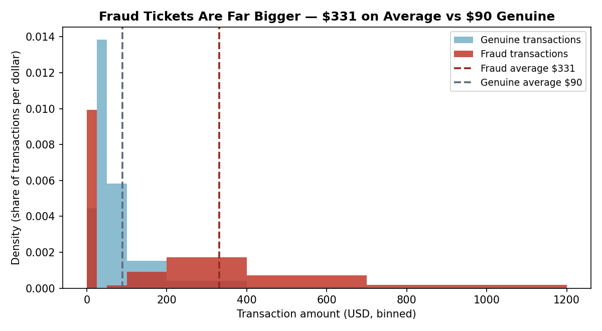
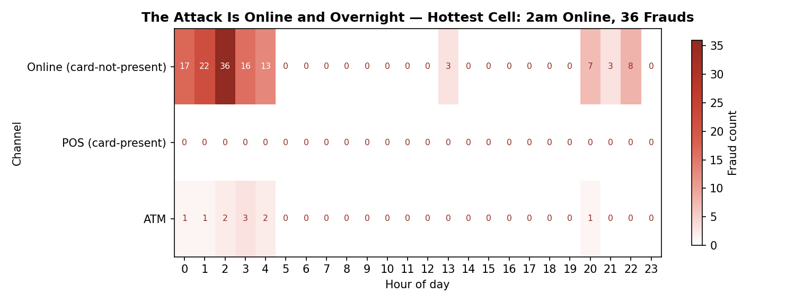
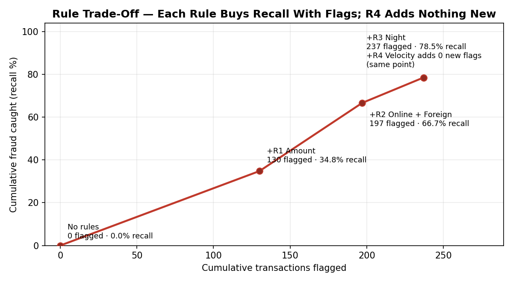
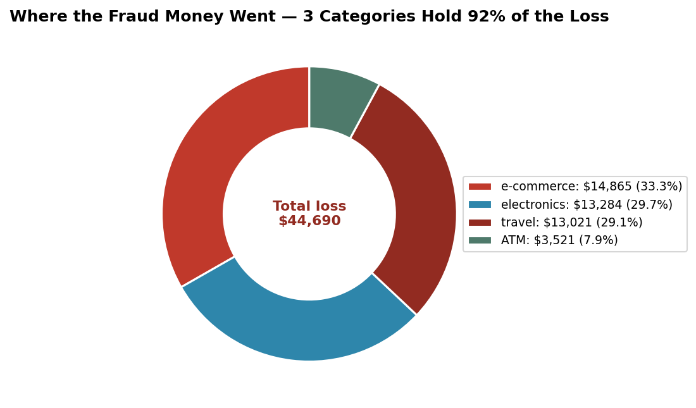
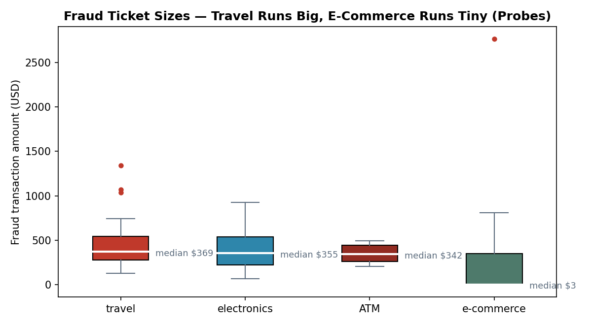
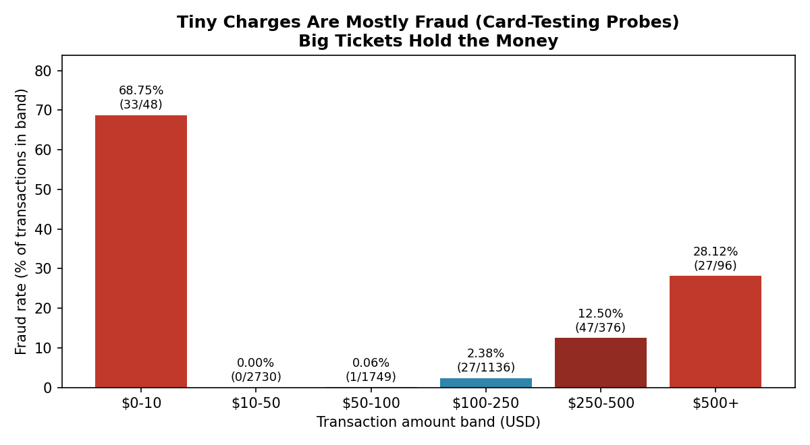
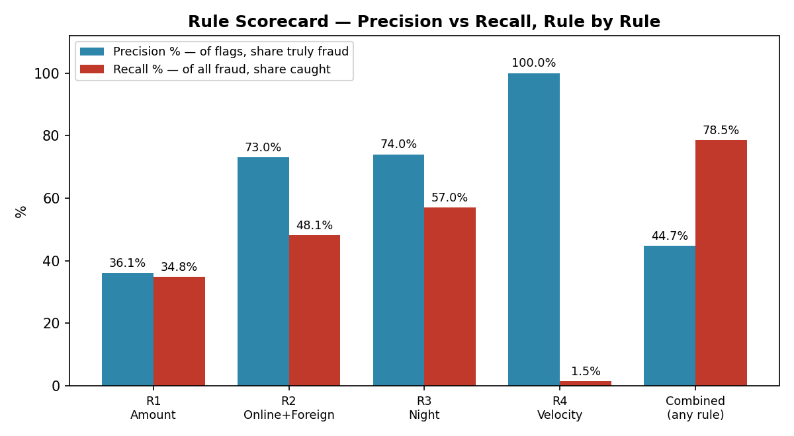
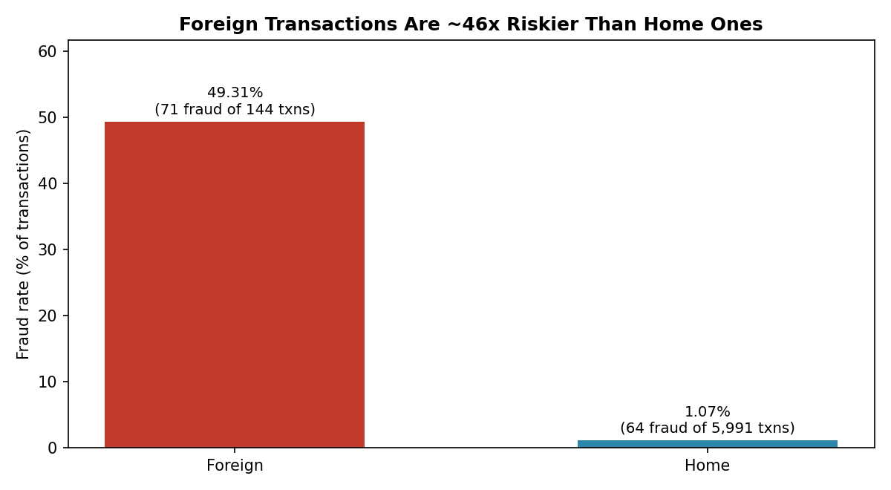
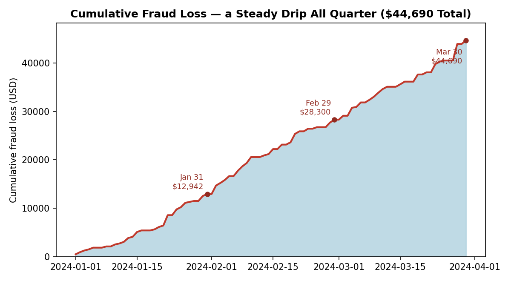

# Card Fraud Analytics: Transaction Fraud Detection, False-Positive Control and Chargeback Analysis

      

> **Portfolio project — synthetic data only.** This repo reproduces the day-to-day work of a **card fraud / payment operations analytics team** at a bank (the Bank of America type of role): monitoring transaction fraud, tuning detection rules, quantifying false positives, and estimating chargeback exposure. No real customer data is used, and this is not paid work experience.

## The problem

Every card issuer loses money two ways: fraud that slips through, and good customers insulted by false declines and fraud alerts. A fraud analyst's job is to measure both sides of that trade-off, find where attacks concentrate (channel, hour, merchant category, geography), evaluate the detection rules honestly, and translate the surviving fraud into the language finance understands — **chargebacks**.

This project does exactly that on 6,135 synthetic card transactions with realistic, planted fraud patterns: card-not-present and foreign concentration, overnight attack windows, big-ticket electronics/travel purchases, sub-$3 **card-testing probes** before large fraud, and **velocity bursts** on compromised cards.

**Questions this project answers:**

1. How much fraud is there, and what does it cost?
2. Where does fraud concentrate — channel, hour, merchant category, geography?
3. Which tiny transactions are card-testing probes rather than shopping?
4. How well do four simple, explainable rules detect the fraud — each rule alone, and combined?
5. What does detection cost in false positives — good customers interrupted?
6. How much money would the rules have saved, and what chargeback exposure remains?

## Project map

- [x] **Data** — 6,135 transactions, 9 columns, one row per card transaction (`data/transactions.csv`, dictionary below)
- [x] **Data quality** — identity, range and reconciliation checks, all passing (section below)
- [x] **Method** — measure first, then four transparent rules, scored honestly (section below)
- [x] **15 headline KPIs** — the learnable set, each defined in [`KPI_DICTIONARY.md`](KPI_DICTIONARY.md)
- [x] **10 charts** — every chart embedded and explained in plain words below
- [x] **Interactive dashboard** — [`dashboard/dashboard.html`](dashboard/dashboard.html) with working filters; every number recomputes live
- [x] **Findings** — numbered, each tied to a KPI or a chart (section below)
- [x] **Recommendations** — what a fraud team should do next, grounded in the findings
- [x] **Limitations** — stated honestly, including the synthetic data and the chargeback assumption
- [x] **How to run** — five commands reproduce everything, tests included

## Headline KPIs (actual outputs from running this repo)

| KPI | Value |
|---|---|
| Total transactions | 6,135 |
| Fraud transactions | 135 |
| Fraud rate | **2.20% = 220 basis points** |
| Total fraud loss | **$44,690.44** |
| Average fraud ticket | **$331.04** |
| Average legitimate ticket | $89.80 |
| Fraud via online (card-not-present) | **92.59%** |
| Rule set — transactions flagged | 237 |
| Rule set — **precision** | **44.73%** |
| Rule set — **recall** | **78.52%** |
| Estimated loss prevented by rules | **$41,916.02** |
| Loss prevented as share of fraud loss | **93.79%** |
| Overnight fraud share (00:00–04:59) | 83.7% |
| Hottest hour × channel cell | **36 frauds** (02:00, online) |
| Fraud rate — foreign transactions | **49.31%** |

Every KPI above — what it means in plain words and exactly how it is calculated: [`KPI_DICTIONARY.md`](KPI_DICTIONARY.md). Supporting detail (home fraud rate 1.07%, foreign share of fraud 52.59%, amount-band rates, the per-rule scorecard) lives in the breakdown CSVs in `outputs/`.

## Interactive dashboard

**[`dashboard/dashboard.html`](dashboard/dashboard.html)** — one self-contained file (no internet needed). It embeds all 6,135 transactions, so **every KPI card, chart and table recomputes exactly under any filter combination**, using the same formulas as `analysis.py`. Open it, filter, and watch precision, recall and loss prevented move.

**Filters:** channel multi-select chips (Online / POS / ATM) · merchant category dropdown (all + 8 categories) · hour range (From / To, 0–23) · location toggle (All / Home / Foreign) · result toggle (All transactions / Fraud only / Legit only).

It shows the 15 KPI cards, three live charts (fraud by hour, fraud rate by category, fraud loss by channel), a per-category results table and the rule scorecard — all for the current selection. The default view reproduces the headline KPIs above exactly. Rebuild it any time with `python3 dashboard/build_data.py`. Power BI build spec with DAX: [`dashboard/dashboard_spec.md`](dashboard/dashboard_spec.md)

## The data

One table: `data/transactions.csv` — **6,135 rows, one per card transaction**, Q1 2024, 600 cards. Full dictionary: [`data_dictionary.md`](data_dictionary.md).

| Column | What it is |
|---|---|
| `txn_id` | Unique transaction ID (`TXN-000001`…) |
| `card_id` | Anonymised card (`CARD-0001`…`CARD-0600`) |
| `txn_datetime` | Timestamp of the transaction |
| `amount` | Transaction amount in USD, always > 0 |
| `merchant_category` | grocery, gas, e-commerce, travel, dining, ATM, electronics, pharmacy |
| `channel` | `online` (card-not-present), `POS`, `ATM` |
| `card_present` | True for POS/ATM, False for online |
| `foreign` | True if the transaction came from outside the cardholder's home country |
| `is_fraud` | Ground-truth label (0/1) — planted here; in real life it arrives late, via chargebacks |

## Data quality

Checks run on the data before any analysis (in `tests/test_kpis.py` and the analysis itself) — **all pass**:

- **Identity:** 6,135 rows, every `txn_id` unique.
- **Ranges:** every amount > 0; `is_fraud` only 0 or 1; channel only online / POS / ATM.
- **Consistency:** every online transaction is card-not-present (`card_present = False`) — 1,998 of 1,998.
- **Reconciliation:** the breakdowns add back to the whole — hour × channel fraud counts sum to 135; monthly transactions sum to 6,135 and monthly fraud to 135; amount-band and foreign/home splits also sum to 6,135.
- **Scorecard arithmetic:** for every rule, true positives + missed fraud = 135; the cumulative trade-off table ends exactly at the combined rule set (237 flagged, 44.73% precision, 78.52% recall).

## Method

1. **Load and check** the transactions; sort each card's history in time order (the velocity rule depends on it).
2. **Measure before building:** fraud rate and loss, fraud vs legit ticket sizes, and where fraud concentrates — channel, hour, category, origin.
3. **Rule R1 (amount):** flag amounts above a per-category limit — aimed at the big-ticket pattern.
4. **Rule R2 (online + foreign):** flag card-not-present transactions from abroad — aimed at the riskiest slice.
5. **Rule R3 (night):** flag non-ATM transactions over $100 between 00:00 and 04:59 — aimed at the overnight window.
6. **Rule R4 (velocity):** flag the 3rd-or-later transaction on a card within 10 minutes — aimed at burst attacks.
7. **Combine and score honestly:** precision and recall per rule and combined, the trade-off curve as rules are switched on one at a time, then translate to money — estimated loss prevented and the chargeback proxy.

## Charts




### Deeper cuts


*Heatmap, in plain words: every square is one hour of the day on one channel, and the number inside is how many frauds happened there. Almost all the colour sits in the online row between midnight and 5am — the single hottest square is 02:00 online with 36 frauds. In plain words: the attack is an internet attack, and it happens while cardholders sleep.*


*Rule trade-off curve, in plain words: each point adds one more detection rule and shows how many transactions we had to flag (left-to-right) to catch how much of the fraud (bottom-to-top). The curve makes the trade-off visible — the first rules buy a lot of fraud caught for few flags; the velocity rule adds nothing new here because its two catches were already flagged by the earlier rules.*


*Donut, in plain words: the ring is all $44,690 of fraud loss, sliced by merchant category. Three slices — e-commerce (33.3%), electronics (29.7%) and travel (29.1%) — hold 92% of the money; ATM fraud is small change by comparison.*


*Box plot, in plain words: each box shows the spread of fraud ticket sizes in one category — the line inside is the middle (median) ticket. Travel fraud is consistently big-ticket; e-commerce is the strange one — its median fraud ticket is just $2.97 because about half of its fraud (33 of 65) is sub-$3 card-testing probes, with one $2,767 outlier showing what the probes are preparing for.*

### Money trail and rule scorecard


*Amount bands, in plain words: each bar is the fraud rate inside one transaction-size band, with the fraud count underneath. The smallest band ($0–10) is 68.75% fraud — those are card-testing probes, criminals checking a stolen card still works. Everyday bands are almost clean ($10–50: 0.00%, $50–100: 0.06%), then risk climbs with size: $250–500 is 12.50% and $500+ is 28.12%. But watch the dollars, not just the rates: the 33 probe frauds cost $65 in total, while the 27 frauds in the $500+ band cost $21,526. The probes are the warning; the big tickets are the wound.*


*Rule scorecard, in plain words: for each rule, the blue bar is precision (when it flags, how often it is right) and the red bar is recall (of all fraud, how much it catches). R4 velocity is never wrong (100% precision) but catches almost nothing (1.5% recall); R3 night is the best single balance (74.0% / 57.0%). The combined set deliberately trades precision down to 44.7% to push recall up to 78.5% — catching more fraud is worth interrupting more good customers, up to a point.*


*Foreign vs home, in plain words: a transaction from abroad is roughly 46 times more likely to be fraud than one at home — 49.31% (71 of 144 foreign transactions) against 1.07% (64 of 5,991). Foreign traffic is only 2.3% of all transactions, yet it carries 52.59% of the fraud and $24,069 of the loss. This is why rule R2 (online + foreign) is so precise: it aims at the riskiest slice of the book.*


*Cumulative loss, in plain words: the running total of fraud dollars, day by day through the quarter. It never dips and never jumps in one disaster — it climbs steadily: $12,942 by January 31, $28,300 by February 29, $44,690 by March 30. A steady drip like this is exactly what always-on detection rules are for; no single clean-up day would have fixed it.*

## Key findings

1. **Fraud is a card-not-present problem:** 125 of 135 frauds are online, a 6.26% fraud rate versus 0.00% at POS in this dataset. Chip/PIN at the terminal is doing its job; the battleground is e-commerce.
2. **Attacks cluster overnight:** 83.7% of fraud lands between midnight and 5am, when cardholders are asleep and slow to confirm alerts — a strong argument for stricter night-time step-up authentication.
3. **Three categories hold nearly all the loss:** e-commerce ($14,864.56), electronics ($13,283.70) and travel ($13,020.99) — high-value, easily resold or refundable purchases.
4. **Rules catch the money, not just the count:** the combined rule set recalls 78.52% of fraud transactions but 93.8% of fraud *dollars*, because it catches the large tickets.
5. **Every rule is a trade-off:** velocity (R4) is 100% precise but fires twice; the amount rule (R1) catches volume at 36.15% precision, interrupting 83 good customers. Tuning is a business decision, and this repo reports both sides.
6. **The heatmap pinpoints the attack window:** of 135 frauds, 104 sit in the online row between 00:00 and 04:59, and the single hottest hour × channel cell is 02:00 online with 36 frauds. POS has zero fraud in all 24 hours.
7. **The trade-off curve shows diminishing returns:** R1 alone catches 34.81% of fraud at 130 flags; adding R2 jumps to 66.67% (197 flags); adding R3 reaches the full 78.52% (237 flags). R4 adds zero new flags on top — its two catches were already flagged — so in this portfolio its value is as a hard-stop safety net, not extra coverage.
8. **February was the peak month, March the expensive one:** fraud rate peaked in Feb 2024 at 2.61% (52 frauds), then fell to 1.91% in March — but March's 39 frauds cost $16,389.96, the most dollars of any month, because the tickets were bigger.
9. **E-commerce fraud is two different crimes:** 33 of its 65 frauds are sub-$3 card-testing probes (median ticket $2.97), while its largest single fraud is $2,766.62 — probes first, then the big spend.
10. **The amount bands expose the probe-then-plunder pattern:** the $0–10 band is 68.75% fraud (33 of 48) yet those frauds cost only $65.43 in total, while the $500+ band is 28.12% fraud and holds $21,525.58 of the loss. A control that ignores tiny fraud because the dollars are small misses the warning signal, not the loss.
11. **Foreign is the riskiest slice of the book:** foreign transactions are 2.3% of volume but 52.59% of fraud, at a 49.31% fraud rate versus 1.07% at home — and $24,068.83 of the $44,690.44 loss. Per transaction, a control pointed at foreign card-not-present traffic works roughly 46× harder than the same control pointed at home traffic.

## Recommendations

- **Step-up verification for foreign card-not-present transactions.** The slice runs at a 49.31% fraud rate, and R2 shows a control aimed there is precise (73.03%) — an extra confirmation step costs little friction per fraud stopped.
- **Tighten overnight online controls (00:00–04:59).** 83.7% of fraud lands there; R3 (night, over $100, non-ATM) is the best single rule at 74.04% precision / 57.04% recall. Lower auto-approve limits or require step-up in that window.
- **Treat tiny online probes as a warning, not a loss.** The $0–10 band is 68.75% fraud but only $65.43 — put the card on a watch list after a probe pattern instead of chasing the dollars; the big spend is what the probes are preparing for.
- **Keep the velocity rule as a hard stop.** R4 adds no coverage on this data, but it has never flagged a good customer (100% precision) and it caps how fast a stolen card can be drained in a burst.
- **Review R1's category thresholds regularly.** R1 interrupts 83 good customers at 36.15% precision; per-card behaviour baselines (what is normal *for this cardholder*) are the next step to cut those false positives without losing the big-ticket catches.

## Detection rules (transparent, no ML)

| Rule | Logic | Precision | Recall |
|---|---|---|---|
| R1 Amount | Amount above per-category threshold | 36.15% | 34.81% |
| R2 Online + Foreign | Card-not-present AND foreign | 73.03% | 48.15% |
| R3 Night | 00:00–04:59, > $100, non-ATM | 74.04% | 57.04% |
| R4 Velocity | 3rd+ txn on a card within 10 minutes | 100.00% | 1.48% |
| **Combined** | Any rule fires | **44.73%** | **78.52%** |

## Repository structure

```
banking-card-fraud-analytics/
├── README.md                  ← you are here
├── LEARN.md                   ← learn-from-scratch course path + interview prep
├── generate_data.py           ← seeded synthetic data generator
├── analysis.py                ← rule engine + KPI evaluation
├── charts.py                  ← 10 matplotlib charts
├── requirements.txt
├── LICENSE  ·  .gitignore
├── data/transactions.csv      ← 6,135 transactions
├── sql/analysis_queries.sql   ← 10 commented SQL queries
├── outputs/                   ← kpi_summary.csv (the 15 headline KPIs),
│                                rule_performance.csv, rule_cumulative.csv,
│                                fraud_by_channel.csv, fraud_by_hour_channel.csv,
│                                fraud_by_month.csv, fraud_by_amount_band.csv,
│                                fraud_by_origin.csv, insights.md
├── images/                    ← 10 chart PNGs (embedded above)
├── dashboard/                 ← dashboard.html (interactive, filterable) +
│                                build_data.py (regenerates it from the data) +
│                                dashboard_spec.md (Power BI + DAX)
├── notebooks/analysis.ipynb   ← notebook reproducing the headline KPIs
├── data_dictionary.md
├── KPI_DICTIONARY.md          ← the 15 KPIs defined, with exact formulas
└── tests/test_kpis.py         ← plain-python KPI tests (PASS)
```

## How to run

```bash
pip install -r requirements.txt
python3 generate_data.py        # writes data/transactions.csv (seeded, reproducible)
python3 analysis.py             # writes outputs/*.csv + outputs/insights.md
python3 charts.py               # writes images/*.png
python3 dashboard/build_data.py # rebuilds the interactive dashboard.html
python3 tests/test_kpis.py      # PASS — all card fraud KPI tests passed
```

Then open `dashboard/dashboard.html` in a browser — it works as a local file, no server or internet needed.

## SQL highlights (`sql/analysis_queries.sql`)

10 commented queries including: fraud rate in **basis points** (the unit fraud teams quote), fraud share by channel with window functions, cumulative loss share by category, hourly pattern extraction, a **velocity query using LAG**, a card-testing probe hunt (small txn → large txn within 24h), a full rule simulation with precision/recall computed in SQL, and a chargeback-proxy estimate by category.

## Interview Q&A

**Q1. Why quote fraud in basis points?**
Because fraud rates are small and bps avoids decimal confusion in executive reporting: 220 bps = 2.20%. A 10 bp move on a big portfolio is real money, and bps makes that move discussable.

**Q2. Your combined precision is only 44% — is the rule set bad?**
Not necessarily. Precision must be weighed against recall and loss prevented: the set prevents an estimated 93.8% of fraud dollars. The honest cost is 131 false positives — good customers interrupted. Whether that trade is acceptable depends on the issuer's friction tolerance, and I'd present both numbers, not hide either.

**Q3. Which single rule would you keep if you could keep only one?**
R3 (night window): 74% precision with 57% recall is the best balance. R4 is perfectly precise but catches almost nothing; R1 catches volume but is mostly noise.

**Q4. How do chargebacks differ from fraud?**
Fraud is the event; a chargeback is the financial mechanism weeks later, when the cardholder disputes and the issuer reverses the transaction under network rules (Visa/Mastercard reason codes). Not all fraud becomes a chargeback, and not all chargebacks are fraud (friendly fraud) — which is why this repo labels the 65% figure a proxy assumption.

**Q5. What would you do next with real data?**
Layer an ML risk score on top of the rules, mature the labels from actual chargeback outcomes, add per-card behavioural baselines (a $600 purchase means different things for different cardholders), and monitor rule performance weekly for drift as attackers adapt.

## 60-second talk track

"Fraud teams live with a trade-off: catch too little and you lose money, flag too much and you insult good customers. In this project I generated 6,135 card transactions with realistic attack patterns — overnight, foreign, card-not-present, big-ticket — and measured a 2.2% fraud rate, about $44.7k of loss. I then built a transparent four-rule detection set and evaluated it honestly: it flags 237 transactions, reaches 78.5% recall at 44.7% precision, and would have stopped $41,916 — 93.8% of the fraud dollars — because it catches the big tickets. The charts, SQL, notebook and tests are all in the repo, and the dashboard is the HTML file in the dashboard folder — it has working filters, so every number on it recomputes live."

## Honest limitations

- **The data is synthetic.** Patterns are planted and labels are clean and final; real fraud labels arrive weeks late via chargebacks, are noisy, and include friendly fraud. The methods transfer; the exact numbers describe this dataset.
- **The 65% chargeback conversion is a planning assumption**, stated openly wherever it is used (chargeback estimate ≈ 88 chargebacks, $29,048.79, in `outputs/insights.md`) — a real planning meeting would work with a range.
- **Loss prevented is an estimate.** It assumes a flagged fraud transaction is stopped before the money is lost; in production some flagged fraud still settles.
- **Rules vs ML:** rule-based detection is explainable — an investigator can say exactly why a transaction was flagged — and it is auditable, which matters in regulated banking. But rules are **static**: thresholds don't learn, there's no risk gradient (a transaction is flagged or not, never scored 0.73), and attackers probe and adapt to fixed rules. Production issuers therefore run ML models (gradient boosting / neural scores) *on top of* a rule layer, with rules kept for hard stops and compliance. Stating these limits plainly is part of doing the analyst job well.

## Disclaimer

Portfolio project built for learning and demonstration. All data is synthetic and generated by `generate_data.py`; any resemblance to real cards, customers or merchants is coincidental. Not affiliated with any bank.

**Learn this project from scratch:** see [`LEARN.md`](LEARN.md) for the full course path, concept checklist and interview drills.
